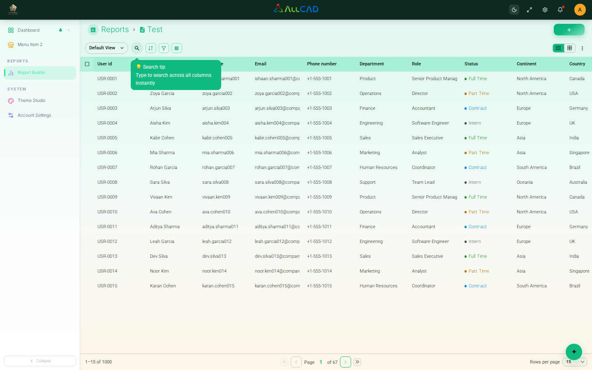
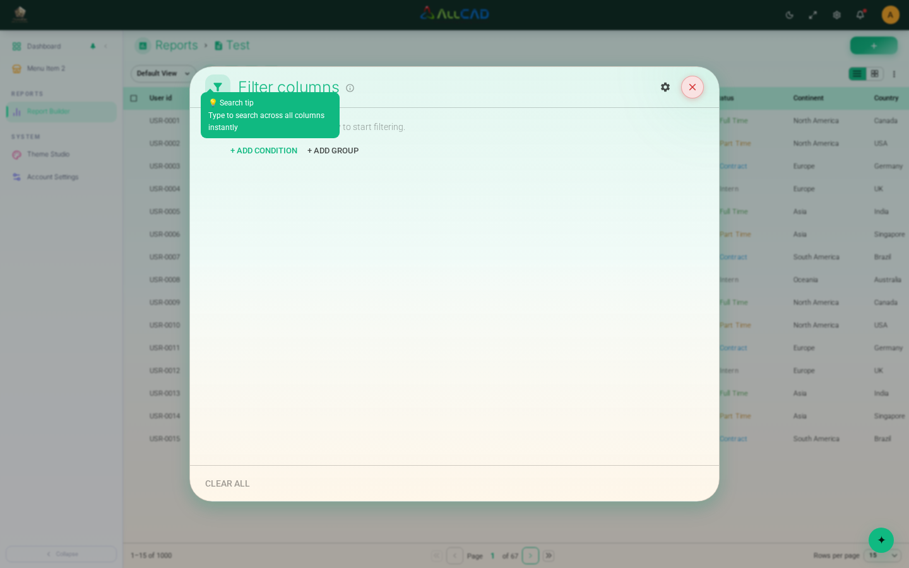
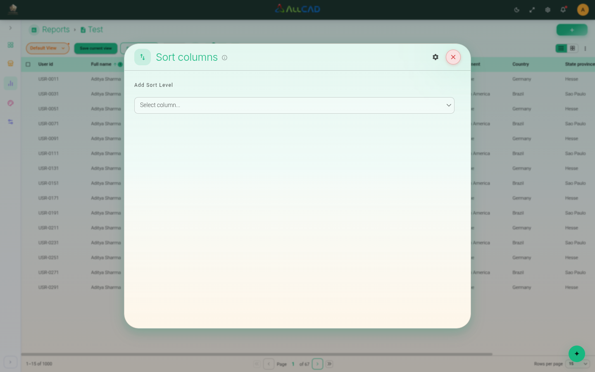

# Defect report

**Build under test:** OomniEye staging — https://base-application-stage.oomnieye.com
**Browser:** Chrome for Testing 156.0.8078.4 (Playwright Chromium 1248), 1440×900, headless
**Account:** general-user staging account (credentials in `.env`, not committed)
**Date:** 2026-10-27

Severity scale: **Critical** = data loss/security; **High** = core flow unusable; **Medium** = significant functional/accessibility issue; **Low** = edge case or cosmetic.

---

## DEF-01 — Failed theme persistence is silent and leaves UI and storage out of sync

| Field | Value |
|---|---|
| **ID** | DEF-01 |
| **Severity** | Low |
| **Priority** | P3 |
| **Component** | Theme Studio / theme persistence |
| **Test** | `tests/theme-edge.spec.ts` → TH-08b (expected failure) |
| **Status** | Open |

**Preconditions:** signed in; a theme has been selected at least once so `localStorage["omnieye-theme-studio"]` exists.

**Steps to reproduce (fault injection):**
1. Open the Report Module with a persisted theme (for example Emerald / Dark).
2. Replace `Storage.prototype.setItem` with a stub that throws `QuotaExceededError` (simulates quota exhaustion, private-mode restrictions, or storage policy).
3. Use the header toggle `Switch to Light Mode`.
4. Compare `document.documentElement.dataset.themeMode` with `localStorage["omnieye-theme-studio"].state.settings.mode`.
5. Reload the page.

**Expected:** either (a) the preference write failure is surfaced to the user and the UI stays on the persisted theme, or (b) the UI applies the change with a visible warning and retry; in both cases UI and persisted state should not silently diverge.

**Actual:**
- UI switches to **light** (`data-theme-mode="light"`, `--page-bg=#ffffff`).
- Storage still contains `mode: "dark"`.
- No user-visible error; the failure is silent.
- After reload the application silently reverts to **dark** — the user's choice is lost.

**Evidence:**

Raw state: `docs/evidence/DEF-01-observations.json`

**Impact:** a user who hits a storage failure believes the theme changed, but it reverts on the next load. No feedback makes it look random and erodes trust. Edge condition (storage quotas/policies are uncommon), hence Low.

**Root-cause analysis:** the theme store commits to in-memory state before/independent of the persisted write. The persistence layer's `setItem` exception is not caught by the UI layer, so there is no rollback, retry, or notification. The write path has no success/failure result consumed by the caller.

**Recommended fix:**
1. Wrap the persistence write and return a success flag; on failure, either roll back the in-memory change or keep it with an explicit "not saved" warning.
2. Add a retry/queue and a one-time toast/inline message for storage failures.
3. Emit telemetry for persistence failures.
4. Add a test that injects a `QuotaExceededError` and asserts UI and storage remain consistent.

---

## DEF-02 — Emerald light-mode accent text fails WCAG AA contrast

| Field | Value |
|---|---|
| **ID** | DEF-02 |
| **Severity** | Medium |
| **Priority** | P2 |
| **Component** | Theme tokens / Report Module typography |
| **Test** | `tests/theme-edge.spec.ts` → ACC-01 / DEF-02 (expected failure) |
| **Status** | Open |

**Preconditions:** theme = **Emerald / Light** (`primaryHex=#10B981`, `--page-bg=#ffffff`).

**Steps to reproduce:**
1. Select Emerald preset and Light mode.
2. Open the Report Module.
3. Measure the breadcrumb/heading text colour against the page background.
4. Open the Filter dialog and measure the `Filter columns` heading against the card surface.

**Expected:** normal-size text meets WCAG 2.1 AA — contrast ratio ≥ 4.5:1.

**Actual:**
- Report breadcrumb `Reports` uses the raw accent `#10B981` on white → **≈ 2.54:1**.
- Filter dialog heading `Filter columns` uses the same accent on the light card surface → **≈ 2.54:1**.
- The same token is used for other accent headings/links, so the issue is theme-wide in light mode, not specific to Report.

**Evidence:**

**Impact:** headings and key labels are hard to read for low-vision users and fail the accessibility threshold; the same preset is likely used in customer-facing branding. Medium severity (accessible alternative themes exist).

**Root-cause analysis:** the preset's brand colour is used directly as a text colour on light surfaces. Accent colours are chosen for fills/branding, where 3:1 UI contrast is sufficient, but text requires a darker "on-light" variant. There is no contrast-aware token derivation or CI gate.

**Recommended fix:**
1. Derive accessible text variants per preset (darken/tone-map the accent until ≥ 4.5:1 against `--page-bg`/`--bg-card`) and expose them as `--primary-text`/`--link-text`.
2. Use those tokens for headings, breadcrumbs and links.
3. Add automated contrast checks for all presets × modes to the theme pipeline (fail the build if below threshold).
4. Re-check dark-mode accents for the same rule.

---

## DEF-03 — Unsupported persisted theme mode crashes the app to a blank screen

| Field | Value |
|---|---|
| **ID** | DEF-03 |
| **Severity** | High |
| **Priority** | P1 |
| **Component** | Theme hydration / application bootstrap |
| **Test** | `tests/theme-edge.spec.ts` → DEF-03 (expected failure) |
| **Status** | Open |

**Preconditions:** signed in; `localStorage["omnieye-theme-studio"]` exists (any theme selected once).

**Steps to reproduce:**
1. With a valid theme persisted, set `state.settings.mode` to an unsupported value (e.g. `"sepia"`) in `localStorage["omnieye-theme-studio"]`.
2. Reload the page.
3. Observe the screen and the console.

**Expected:** unsupported values are validated/coerced during hydration (fallback to `light`/`dark`), the stored value is repaired, and the app renders normally. This matches the behaviour observed for an unsupported **preset**, which falls back gracefully.

**Actual:**
- `#root` is empty and the page is blank white (no header, no Report).
- URL remains `#/dashboard/reports`.
- Uncaught error: `TypeError: Cannot read properties of undefined (reading 'disabled')`.
- Only clearing `localStorage` (or site data) recovers the app; there is no in-app recovery path.

**Evidence:**

**Impact:** High — the application is completely unusable for that browser profile until storage is cleared. The state can be reached through corrupted storage, a downgraded/renamed theme option, a bad import, or manual/extension edits. A single bad value bricks every route, including the login screen.

**Root-cause analysis:** the persisted mode is trusted during hydration and used to index the mode token map without a whitelist check. For an unknown mode the lookup returns `undefined`, and a property read on that undefined value (e.g. a disabled/flag field) throws during the first render. There is no error boundary and no storage migration/validation for unknown values. The preset path already contains a fallback, so the two persisted fields are handled inconsistently.

**Recommended fix:**
1. Validate both `mode` and `presetId` on rehydration against explicit whitelists; coerce to safe defaults (`mode: "light"`, default preset) and persist the repaired value.
2. Add a schema version + migration step for `omnieye-theme-studio`.
3. Guard every token-map lookup (`MODE_TOKENS[mode] ?? MODE_TOKENS.light`).
4. Add a top-level React error boundary that renders a recoverable screen with a "reset appearance" action.
5. Add hydration tests with hostile persisted values (unknown mode, null, prototype keys, truncated JSON).

---

## DEF-04 — Sort `Clear all` does not close the panel or clear the applied sort immediately

| Field | Value |
|---|---|
| **ID** | DEF-04 |
| **Severity** | Low |
| **Priority** | P4 |
| **Component** | Report Module / Sort panel |
| **Test** | Manual (MAN-17); evidence captured during exploration |
| **Status** | Open |

**Preconditions:** Report Module; no sort applied.

**Steps to reproduce:**
1. Click `Sort` → add a sort level: `Full name` / `Ascending`.
2. Close the panel and choose `Save changes`; confirm the table is sorted by Full name.
3. Re-open `Sort` and click `Clear all`.
4. Observe the panel and the table.
5. Try to click a toolbar control (for example `Filter`) while the panel is in this state.

**Expected:** the accessible name of the control is *“Removes all applied sorting and closes this panel”* — the panel should close and the applied sort should be removed immediately (or the control should be labelled and behave as “clear draft” while keeping the panel open).

**Actual:**
- `Clear all` removes the draft sort levels but **leaves the Sort panel open**.
- The table **remains sorted** by the previously applied sort until the user closes the panel and chooses `Save changes`.
- While the panel is open it continues to block toolbar clicks (normal for a modal, but contrary to the control's stated behaviour).
- Closing after `Clear all` still shows the `Unsaved changes` prompt; `Save changes` then clears the sort.

**Evidence:**

**Impact:** Low — confusing UX and a misleading accessible name; no data loss. A keyboard/screen-reader user is told the panel will close and the sort will be removed, but neither happens.

**Root-cause analysis:** `Clear all` mutates only the editor's draft state. The applied sort is committed by a separate save/close transaction. The button's `aria-label` (and its help text) describes the committed outcome, so the label and the behaviour disagree.

**Recommended fix:**
1. Decide the intended contract and make label + behaviour match:
   - Option A: `Clear all` clears the draft **and** commits + closes (single action).
   - Option B: rename to `Clear draft`, keep the panel open, and show that changes are not yet applied.
2. If the panel stays open, ensure focus/aria state makes the “unsaved” state explicit and prevent the invisible panel area from blocking unrelated controls.
3. Add a functional test for sort apply → clear → save/close.

---

## Observations that are not defects

| Observation | Assessment |
|---|---|
| Theme is stored only in `localStorage`; no API/account sync | Consistent with the application design; no requirement for server-side sync was stated |
| Authentication uses `sessionStorage`; a new tab requires sign-in | Browser design, not a theme defect; theme still applies immediately |
| A tab already open before a theme change does not live-update | No `storage` event listener; next reload/navigation applies the change. Recorded as a limitation (Low) rather than reported, since no requirement specifies live cross-tab sync |
| Header stays dark in light mode | Caused by **Global Settings → Header Branding** (`#141b3c`), not the theme; treated as intended |
| Default theme is not written to storage on first visit | By design — the key appears after the first user change |
| `Reset to defaults` did not visibly change the current preset during exploration | Contract unclear; not asserted; recommend clarifying the expected reset scope with the product owner |
